# Pixel audit: Code Clash art against the three pixel-art guides

This audit checks the battle sprites (classic 48 and HD at levels 1, 2, 4 and 8), the city (classic and HD, all three factions, tiers 0-4, day and night) and the post finish. They are measured against `pixel-art-craft.md`, `pixel-art-techniques.md` and `pixel-art-mistakes.md`. All the numbers come from the new lint, `pnpm pixel-lint` (`scripts/pixel-lint.ts`). Its full output is in `docs/art-references/pixel-lint/pixel-lint.md` (tables per faction × kind × level and per city faction × tier × day/night) and `pixel-lint.json`. The screenshots below show our own art only. Third-party images stay in `references/`.

**Scope.** The audit only measures. It changes no art. Each violation gives the code to change and a concrete fix, for the agents who will apply them.

## How the lint works

- **Sprites** are painted in Node, using exactly the app's painters through Vite's SSR loader. A transform plugin re-exports four module-private tables (`makeRamps`/`armyColours`, `R`, `FRAMES`, `COLS`), so every pixel can be labelled with its material ramp and tone. The source files are untouched. Each sprite is judged on idle frame 0 facing SE, its 8-frame (HD) or 4-frame (classic) idle loop, and its walk loop, all at hue 215 on the preview's field green `#56603a`.
- **The city, the screens and the reference images** go through Vite plus headless Chromium (Playwright). For the city, the lint reads the art-resolution world buffer after grading, the building-part canvases before grading, a building mask and the bare ground. For the screens, it reads the output canvas at three page widths and the battle through the post shader.
- **Metrics** live in `scripts/pixel-lint/metrics.ts`. They are pure and deterministic, and use OKLab/OKLCH throughout:
  - colour count, near-duplicates and pure black or white;
  - same-colour 4-connected clusters (orphans, mean size, edge density);
  - jaggies on the four silhouette profiles (spikes, or run reversals that aren't a periodic 2- or 3-pattern) and L-corner doubles;
  - pillow shading: the `pillow_metric.py` port, per material region;
  - light direction: luminance centroid against the key light, per region;
  - banding as edge-hugging bands, stacked 1-px steps and aligned band ends (Pixel Fixer's definition);
  - 2×2 checkers;
  - outline closure, near-black share, chroma and lit-minus-dark;
  - value bands, 3-value thumbnail, ΔL against the ground and part-to-part ΔL;
  - silhouette IoU between kinds at level 1 (best of ±2 px shifts);
  - temporal checks: churn after the best ±2 px shift, head-region churn, lone A-B-A flips and silhouette change;
  - grid detection and mixels (art-pixel size per 8×8 tile);
  - iso 2:1 runs on ground-plane stairs.
- **Runtime.** A full run takes about 20 minutes: 165 sprites, 60 city scenes and 10 screens. `--quick` takes about 2 minutes (HD levels 1-2, two tiers, no screens). `--only=sprites|city|screens|calibrate`, `--factions=` and `--levels=` narrow a run, and `--strict` exits with 1 on any fail.

## Calibration: do the metrics separate good from bad?

All of these were run on the guide's PixelJoint/Slynyrd pairs in `references/pixel-mistakes/`. Each picture was first taken back to native pixels by grid detection. The "hand-approved" baseline is the xave "128" girl from `references/comparisons/`.

| metric (guide row) | bad | good | separates | threshold set |
|---|---|---|---|---|
| pillow corr(L, edge distance) (#1), skull pair 1 | 0.72 | 0.20 | **yes, clean** | warn 0.40, fail 0.50 when corr(L, light) < 0.35 |
| corr(L, light axis), same pair | 0.03 | 0.66 | **yes** | (gate above) |
| pillow, skull pair 2 (frontal light) | 0.72 | 0.26 | **yes** | |
| hugging bands (#2) | 0.86 | 0.24 | **yes** | warn 0.6, fail 0.8 (xave 0.53 with its outline excluded) |
| aligned band ends (#2, column banding) | 0.066 | 0.033 | yes, but weak: **xave scores 0.30** | warn 0.2, fail 0.3 (set at xave's value; treat with caution) |
| stacked 1-px steps (#2/#15), too-much-AA pair | 0.53 | 0.21 | **yes** | warn 0.30, fail 0.45 |
| stacked steps, AA-banding image vs another image's good AA | 0.11 | 0.21 | **no**: cross-image pairs aren't comparable | |
| blur tool vs clean AA | 0.59 | 0.21 | **yes** | |
| jaggies per 32 px (#3) | 1.94 | 0.00 | **yes, clean** | warn 1.0, fail 1.5 (croc 0.31, xave 0.91) |
| broken sel-out adds jaggies (#3/#9) | 0.34 | 0.31 | barely | |
| 2×2 checkers per 1000 (#6) | 198 | 42 | **yes** | warn 10, fail 40 (xave 9) |
| orphans, random dither vs buffer dither (#5) | 5.3% | 4.5% | weakly | thresholds set from xave (11% with outline, 7.6% without) scaled by level; the guide's 1-2% fails every hand-made sprite measured |
| outline closed (#9), solid vs broken sel-out | 0.963 | 0.971 | barely | warn < 0.6 (xave 0.71) |
| lit minus dark outline L (#9), light-shaded outline vs sel-out ignoring light | 0.18 | 0.32 | **yes** | warn < 0.05 (HD levels ≥ 2) |
| value (#12), the guide's k-means spread, low vs improved pug | 0.353 | 0.355 | **no in practice** (+0.002) | the actionable value checks are ΔL to ground: edge ≥ 0.15 (guide), mean ≥ 0.12 (techniques) |
| 3-value thumbnail score | 0.867 | 0.866 | **no** | info only |
| JPG damage (#10): colours | 232 | 21 | **yes** | |
| JPG damage (#10): impure 4×4 blocks | 0.074 | 0.068 | barely | |
| straight ramp strip `pj_9iGrBo9` | hue drift 0.4° | (no shifted twin on file) | flags it | warn > 10% of fill px on ramps drifting < 5° |
| iso 2:1 (#17) | true 30° line: 73% runs of 2 | Slynyrd cubes 100%, synthetic 2:1 100% | **yes, clean** | warn < 90%, fail < 80% |

What the calibration taught us:

- **Thresholds the guide got about right:** pillow (0.5 sits between 0.72 and 0.2-0.26), iso 2:1, checkers and jaggies.
- **Thresholds that are far too strict for real hand-made art:** orphans (1-2%) and near-duplicates (0; xave has 278 pairs). We moved orphans to level-scaled limits taken from xave, and near-duplicates to info only.
- **Metrics that don't separate the pairs:** the guide's value-band test and the 3-value thumbnail score. We use ΔL to the ground instead.
- **The whole-sprite light-direction test is fooled by albedo.** On xave it reports light from below, because the hair is dark at the top and the legs are light at the bottom. On our sprites we run it, and the pillow test, **per material region** from the ramp labels.
- **Silhouette IoU and boil had no reference pair.** We used the guide's numbers (IoU 0.85, churn 3%).

## Ranked violations (worst first)

The counts are fails / items checked, at the calibrated thresholds. Code locations are as of this branch.

### 1. Boil: static parts re-rasterise every idle and walk frame (mistakes #16, craft §3.1, techniques §7.5)
**Measured:** after the best whole-sprite shift of ±2 px, the head and helm (top quarter of the figure) still change on every idle frame. The median head churn is **17% in classic, 10-13% in HD at every level**, against the guide's 3%. That is 30/33 classic fails and 101/132 HD fails. Walk head churn is 14-22%, with 21/33 classic and 72/132 HD failing.

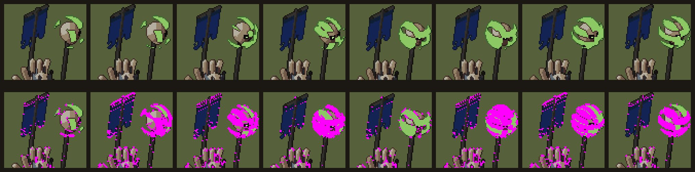

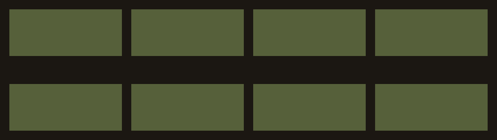

(Part of the Lich-Marshal's top quarter is the animated green staff glow, which is meant to move. The banner edge and the hand speckle are not. `boil-idle-classic-templar-k8-L1.png` shows plain boil.)

**Code:**
- `sprites128.ts` `manPose()` (around l. 857-858) and the same lines in `sprites.ts`: `p.bob -= 0.18*(…cos…)` and `breathe = 0.15*sin(…)` move the whole model by sub-pixel amounts.
- `KEYS`/`FRAMES` (l. 30-32): 4 idle keys are in-betweened into 8 frames.
- `texture()` (l. 3014): the mail checker and the gambeson channels are keyed to **cell** x/y, so they slide over the moving body.
- `steady()` (l. 2953): it only reverts a lone flip when 3 of 4 neighbours agree.
- Classic `finish()` (`sprites.ts` l. 2456) has no temporal pass at all.

**Fix:**
- Snap `bob` to whole pixels per level (`Math.round(bob*LV)/LV`).
- Make breathing a ±1 px shift of the chest and shoulders only (Saint11: move light, not shape).
- Hold idle on 4 painted keys.
- Rasterise rigid parts (head, helm, shield) once per facing and level, and blit them at integer offsets.
- Give the band thresholds hysteresis from `PREV` (keep the previous tone unless N·L crosses the threshold by ε ≈ 0.06).
- Key `texture()` to part-local coordinates (the hit point `LS`), not the cell.

### 2. Kinds share one silhouette at minimum zoom (mistakes #13, craft §4)
**Measured:** pairs with level-1 IoU above 0.85:
- **classic Samurai:** 9 pairs, including Yari Cavalry/Hatamoto Horse **0.96**, Yari Ashigaru/Yumi Ashigaru **0.94**, Yumi/Teppō 0.90 and Hatamoto/Daimyō 0.90;
- **classic Templar:** 5 pairs, including Turcopoles/Turcopole Archers 0.92, Turcopoles/Knight-Brothers 0.88 and Sergeants/Javelin Men 0.87;
- **Undead:** Black Riders/Death Knights 0.90 in both arts;
- **HD:** 2-5 per faction.

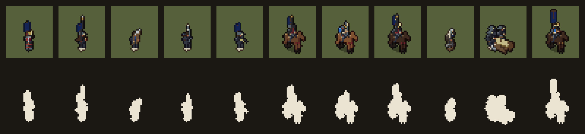

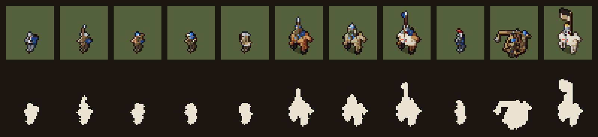

**Code:** the look tables `FOOT`/`RIDERS` (`sprites.ts` l. 2236 on) and `SAMURAI_FOOT`/`SAMURAI_RIDERS`/`UNDEAD_*` (`sprites128.ts` l. 2622 on), the idle poses in `manPose()`, and `EX` (the signature-part scale, 1.25-1.3 at level 1).

**Fix:** give every kind one signature shape that stands out from the body mass in idle:
- Yumi: the tall bow held out to the side, at EX ≈ 1.6.
- Teppō: the barrel shouldered at 45°.
- Yari: the spear vertical and extended above the head.
- Hatamoto: a horo cape balloon or a tall sashimono, different from the Yari cavalry's.
- Daimyō: a large banner.
- Turcopole Archers: the bow raised. Knights: the lance upright with a pennon.
- Death Knights: barding plus a lance; Black Riders: tattered cloak streamers.

Re-run the IoU check until no pair is above 0.85.

### 3. Too many colours and near-duplicates (mistakes #7, craft §1.5)
**Measured:**
- Classic level 1, a figure about 13 px tall: a median of **27 colours** (Knight-Brothers 43, Mangonel 41), 27/33 fail.
- HD: a median of 26/31/36/38 at L1/L2/L4/L8, with Turcopoles at L8 reaching **62**. 74/132 fail.
- 14-42 near-duplicate pairs per sprite.

**Code:**
- 49 ramps × 4 tones (`makeRamps`, `sprites128.ts` l. 180; `sprites.ts` l. 151).
- One outline colour per ramp (the `edge` table, `sprites.ts` l. 2520, `sprites128.ts` l. 3163), so every material adds another dark.
- Many materials are near-identical (`mail`/`rmail`/`plate`/`steel`, `leather`/`dleather`/`hair`, `tunic`/`hose`).

**Fix:**
- Map each faction's ramps onto a master palette in OKLab: weight L ×2, keep L monotone along each ramp (techniques §7.1), and merge ramps whose base steps are within ΔE 0.04.
- At level 1, cap the figure at about 8 ramps and use 2-3 shared outline colours per faction.

### 4. Noise at the small levels: orphans and tiny clusters (mistakes #5/#14, craft §3.5)
**Measured:**
- Classic L1: median **38% orphans** (with the outline excluded), mean cluster 1.7 px, edge density up to 0.87.
- HD L1: 29% orphans.
- HD L2 (10%) and L4/L8 (4%/1%) are fine.

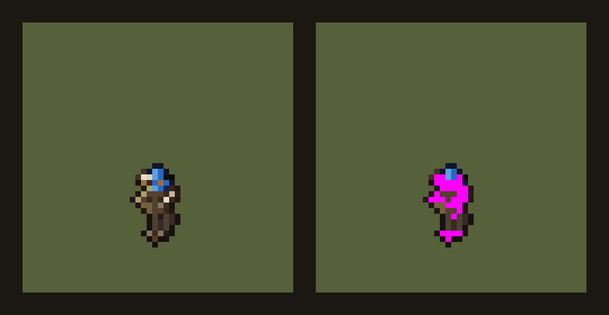

**Code:** classic `finish()` runs a single tone-majority pass (`sprites.ts` l. 2459-2474). HD `tidy()` skips `orphans()` and `clusters()` below level 2 (`if (LV >= 2)`, `sprites128.ts` l. 3058-3059).

**Fix:**
- Run `orphans()` and `clusters()` at level 1 too, with a minimum of 2.
- At level 1, use 3 tones (drop tone 3 except on spec-tagged pixels), so a 13 px figure is masses plus one accent (craft §0, "design the 32-px read first").

### 5. Banding: band ends align between parallel parts, and bands hug edges (mistakes #2, techniques §1.1)
**Measured:** the aligned-band-end score has a median of 0.31 in classic (19/33 fail) and 0.16-0.28 in HD (22 fail, 70 warn). Hugging bands are 0.27-0.38 at HD L2-L4, which passes, though some kinds (Crossbows L4) hug the shield and body edges.

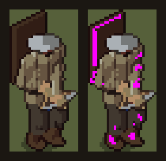

**Code:** `put()` uses one threshold set per art (`sprites128.ts` l. 371: `0.62/0.86, 0.08, -0.38`; `sprites.ts` l. 298: `0.6, 0.12, -0.32`) on smooth N·L, and every limb is a capsule or ellipsoid, so parallel cylinders band in step.

**Fix:**
- Snap normals to about 26 directions per part before lighting (techniques §2.1, planar faces).
- Use per-material thresholds, with the base band widest (≈ [-0.15, 0.25, 0.8]).
- Add a deterministic threshold offset hashed on part-local coordinates (`hash2` already exists), so neighbouring parts end their bands on different rows.

### 6. Near-black outlines on dark materials (mistakes #9 "pure black outline", craft §3.4)
**Measured:** a median 21% of the outline ring is near-black (all channels ≤ 16) at HD L1, and 12-16% at L2-L8. On the Undead it reaches **67%** (Wraith Bows), and 79% on classic Wraith Bows. 29 HD fail and 45 HD warn. xave's sprite has 0%.

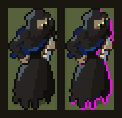

**Code:** the outline colour is `deep*0.45 + 6` (`sprites.ts` l. 2520, `sprites128.ts` l. 3163). In HD, `armyColours()` (l. 3143) has already darkened tone 0 to ×0.78, so dark ramps (`black`, `rag`, `bplate`, `lacquer`, `hair`) give `#0c0a09`-like outlines.

**Fix:** build the outline in OKLab: the deep tone with L − 0.08, floored at L 0.16, with chroma ≥ 0.02 and the material's hue. On the lit side, use the material's tone 1 (see #14).

### 7. Figures sit on the ground's value (techniques §3.1, mistakes #12)
**Measured:** the figure's mean ΔL against the field green has a median of 0.08 (classic) and 0.09-0.13 (HD), against a target of ≥ 0.12. Fails include classic Knight-Brothers (0.004) and HD Marshal (0.004 at L1), with Iron Brethren and Knights at L8 also failing: 8 classic and 21 HD in all. The outer outline still separates them, at an edge ΔL of about 0.25 (pass).

**Code:** the material base values in `makeRamps()` (`tunic #73603f`, `gambeson #9d8c66`, `dun`, `bay` and the horse ramps) all sit around L 0.45-0.5, the same as the battle ground. In HD, `armyColours()` pushes everything 12% darker, toward the terrain mid.

**Fix:** keep figure mid values out of the terrain's mid range, which is roughly L 0.42-0.52 for the battle field in `ground.ts`. Lift the cloth and surcoats (Templar white is fine) and darken leathers and horses one step. Re-run with the real battle ground colours, not only the preview green.

### 8. The city goes flat at night (mistakes #12, techniques §1.2/§5.5)
**Measured:** at night, building silhouette edge ΔL falls to **0.06-0.09**, against 0.12-0.31 by day. That is 12/30 classic fails and 9/30 HD fails (all Undead night scenes). Building-against-ground mean ΔL is under 0.12 in 58/60 scenes.

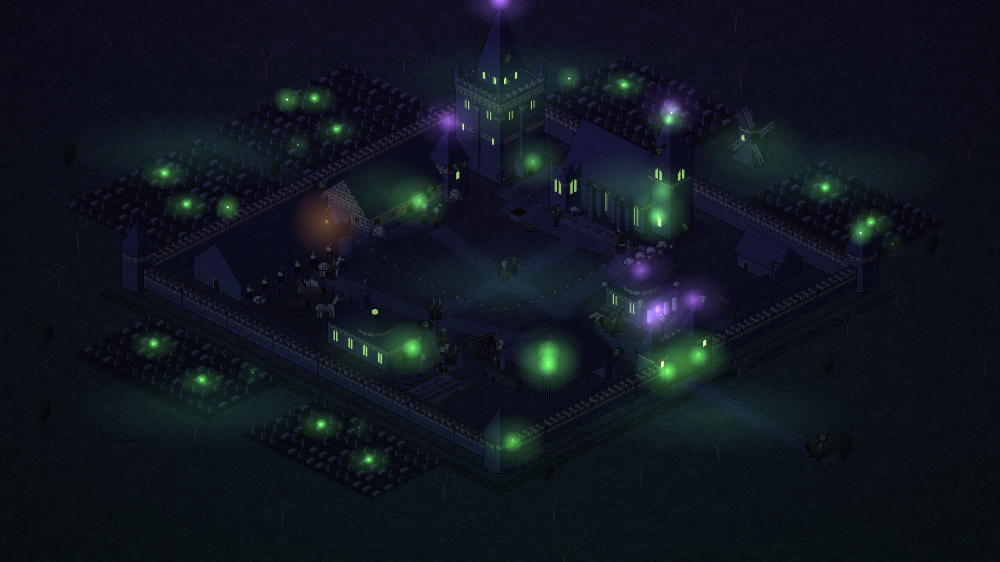

**Code:** `CityScene.gradeHd()` (`city.ts` l. 503-542) multiplies the whole buffer by one night colour, so the value ratios between roof, wall and ground are kept but their differences shrink. The classic city uses `Post.apply()` plus `light()` (l. 631). There is no rim or moon term.

**Fix:**
- Make night a palette and rig change (techniques §1.2, §5.5), not a multiply: a cool moon key from the upper left that keeps the top/left planes one step lighter.
- Add a 1-px moonlit highlight on top-front convex edges (techniques §2.5).
- Keep windows and witchfire emissive, exempt from the grade.
- Target an edge ΔL ≥ 0.15.

### 9. Dither and noise in city textures (mistakes #5/#6, techniques §2.4)
**Measured:**
- Classic ground: **28-30 checkers per 1000 px** and 23% orphans (warn on all 30 scenes).
- Classic building parts: 23 per 1000 at tier 4 and **62 at tier 0**, with 16-28% orphans (18 fail).
- HD Samurai parts: 22 per 1000. The HD ground is clean (5 per 1000).

**Code:** `city/ground.ts` `paintGround()`, and the hash-per-pixel shaders in `city/buildings.ts`, `samurai.ts` and `undead.ts` (they call `hash(x, y, …)` per pixel to pick a tone).

**Fix:** replace per-pixel hashed tones with 2-5 px stamps placed at hashed world points, on lit faces only. Use Bayer 2×2 only on the boundary between adjacent ramp steps.

### 10. Grain, chromatic split and temporal noise at screen resolution (mistakes #10, techniques §7.6)
**Measured:**
- In battle screenshots, **100% of art-pixel blocks are not flat**, with a mean deviation of 12-13/255 at 1 px per map px and 5-6 at 2 px. The art grid is gone, which is what the guide calls "softening the crisp edges the ray-caster worked for".
- The classic city redraws `Math.random` grain every frame at buffer resolution, so the whole picture shimmers.

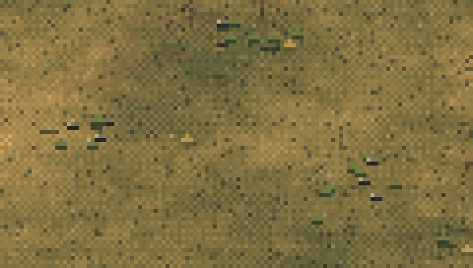

**Code:** `post.ts` `POST_FS`. Grain is `hash(dev + fract(u_time)*97.0)` per **device** pixel, and the chromatic split `fetch(dev ± cdir)` is up to 1 device pixel. `Post.apply()` uses a fresh random tile and offset per frame.

**Fix:**
- Hash grain on the art pixel (`floor((dev - u_off)/u_px)`).
- Step its seed at 2-4 Hz, or make it static per world position, with an amplitude of about 0.02.
- Quantise or drop the chromatic split so it moves whole art pixels.
- In `Post`, pick the grain tile and offset from a frame counter at ≤ 4 Hz, or drop the grain.

### 11. HD city scales by a non-integer factor on smaller pages (mistakes #10)
**Measured:** on a 1024 px page, `scale = 0.8` and 76% of blocks are mixed, which is visible as uneven pixel widths. 1366 px gives 1.0 and 1920 px gives 2.0, which are fine.

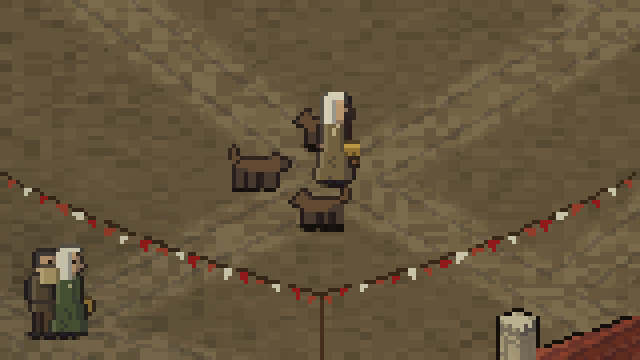

**Code:** `CityScene.scale()` (`city.ts` l. 130-142): `fit >= 1 ? round(fit) : fit`.

**Fix:** when fit < 1, keep 1× and let the view pan (it is already clamped), or fall back to the classic buffer. The classic buffer reached 2-4× integer scale at every width tested. Alternatively, use sharp-bilinear (craft §5).

### 12. Jaggies on HD silhouettes (mistakes #3, craft §3.5)
**Measured:** 16 fail and 24 warn in HD. The worst are Undead Legionaries L1 at **4.0 per 32 px**, Revenant Arbalests L1 at 2.6 and Templar Knights L2 at 2.5. Classic has 4 fail (Turcopoles 3.1).

**Code:** `silhouette()` (`sprites128.ts` l. 2920) only runs at level 4 and above, and only trims 1-px spurs and notches. Thin props are ray-cast as capsules (`rCap`), with `rLine` (l. 569) for strings.

**Fix:** run a run-evening pass on the alpha mask at every level: where a profile run differs from both neighbours by more than 1, or reverses non-periodically, shift one pixel. Rasterise long shafts as 2D lines after projection, snapped to 1:1, 1:2 or 2:1 where the pose allows (craft §2 "weapons").

### 13. Pillow-like edge darkening at HD L2 (mistakes #1)
**Measured:** per material region at HD L2, the median corr(L, edge distance) is **0.38** with corr(L, light) **0.03**. The calibrated pillow pair is 0.72 against 0.20. At L4 it is 0.29/0.17, and at L8 0.24/0.26. None fail; the worst warn at 0.47 (Mangonel L2).

**Code:** in `put()` (`sprites128.ts` l. 372), `if (inner && tone > 0) tone--` darkens every inner hit. The inner-line pass in `tidy()` (l. 3061-3083) darkens the farther pixel at every depth step, on all sides, so each part gets a dark rim whatever the light direction.

**Fix:** apply the inner darkening only where N·LC < 0.2 (the shadow side), and draw inner lines only on the shadow-side edge of the front part (mistakes §1.1 fix).

### 14. Selective outline barely lighter on the lit side (mistakes #9, craft §3.4.2)
**Measured:** the outline's lit-minus-dark ΔL is 0.02-0.04 in HD (72 warn), against **0.32** for PixelJoint's light-shaded outline. Some kinds are negative, for example the Teppō at -0.011.

**Code:** `finish()` (`sprites128.ts` l. 3125-3136) treats only the left and top outline pixels as lit, and gives them the neighbour's **tone 0** (`fill[(nb & ~3) | 0]`), which is nearly as dark as `edge`. Classic has no lit-side variant at all.

**Fix:** on the lit side, use tone 1 of the neighbour (or drop the outline when the neighbour's tone is 3). Choose the side with the edge normal · LC > 0.5 instead of a fixed left/top test. Do this at level 1 too.

### 15. HD city: ground textures at a coarser grid than the buildings; minor iso runs (mistakes #10/#17, Slynyrd tile density)
**Measured:**
- At tiers 0-1, 12-17% of detailed tiles in the HD buffer are at the minority art-pixel size (6 warn). The courtyard and flagstones are flat 2×2 blocks next to 1-px building art.
- The iso 2:1 check passes overall: 94-96% of ground-plane stair runs are 2. Classic tier 2 and HD Undead tier 1 are at 0.79/0.69. The 1- and 3-runs sit on wall foot lines and merlons.

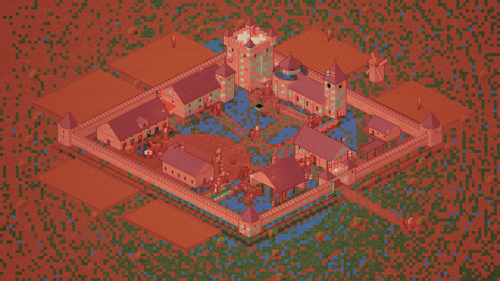

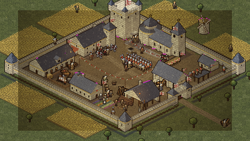

**Code:** `city/ground-hd.ts` `staticGround()` `paintRow` (l. 66-120) tests `u % 5`, `v % 4`, and the yard rectangle, in world units: one unit is 2 buffer px. The wall and merlon boxes are in `city/pixels.ts` `box()` (l. 281) and `buildings.ts`.

**Fix:**
- Make the texture tests work on buffer pixels, or as stamps designed at 1 px, so the ground has the same grain as the buildings.
- Round box vertices to even u + v, so their edges start on a 2-run.

### Other findings, lower priority
- **The classic city ignores the faction.** All metrics for classic Samurai and Undead equal Templar's to three decimals. `paintBuilding()` (`buildings.ts` l. 432) uses the faction `KITS` only when `frame.k > 1`.
- **The baked contact shadow is half-transparent** (alpha 92, `finish()` in both painters). The battle shader discards alpha below 0.5 (`gl.ts` l. 140), so the ellipse is dead weight there. The battle already has a stencilled shared shadow (`scene.ts` l. 645-654). Drop the baked shadow or make it hard-alpha.
- **Ramps.**
  - `teamDark` (0.6°), `blood` (3.1°) and classic `tunic2` (3.7°) are straight ramps.
  - In 30/35 HD coloured ramps the chroma does not peak at the shade step (techniques §1.1). `ramp()` is HSL and pushes saturation into the darks.
  - No grey shadows were found: the warm/cold rule in `ramp()` works.
  - See `ramps-hd-templar.png` and `ramps-classic-templar.png`.
- **The base band is narrow on some kinds** (warn when < 35%): Undead Legionaries are 16-20% at L2-L8, and classic Samurai archers 23%.
- **Light direction per region** is reported more than 90° off on a few HD L2 foot kinds (Spear Levy 176°, Javelins 172°). This is probably the same inner-darkening as #13, which pulls the light centroid toward the lower right. It will be re-checked after #13.
- **Checkers on figures** (no mail): classic Undead Bone-Throwers 26 per 1000 and the HD Undead Ghoul Spears L4 cluster (`checkers-hd-undead-k1-L4.png`). Warn level only.

## What the guides recommend that we don't do at all

1. **Ramp-id + tone + normal atlas and a palette-lookup shader** (techniques §1.4, §3.5, §5.2). The atlases store finished RGBA, baked per army hue (`buildAtlas(faction, hue)`). There is no team mask, no scene LUT on the palette, no torch-light buckets and no palette hit flash: the `flash` in `scene.ts` l. 901 is an additive tint.
2. **OKLCH ramps and LightRigs** (techniques §1.1-1.2). `ramp()` is HSL with fixed hue targets (205/330/55/28). There is no day, dusk or night rig.
3. **Band-threshold hysteresis** (Schmitt trigger on `PREV`, techniques §7.5). `steady()` only reverts lone flips. Classic has no temporal pass at all.
4. **Normal snapping / planar faces** (techniques §2.1). Normals are continuous, which is the root of #5 and #13.
5. **Object-space texture stamps** (techniques §2.4). Mail and gambeson textures are keyed to the cell, and the city uses per-pixel hashes.
6. **Emissive tag, palette halo, and bloom only on emissive pixels at screen resolution** (techniques §1.6, §5.1). The city lights are smooth radial-gradient canvases drawn at art resolution (`radial()` in `city.ts`, l. 848), which give off-palette smears. There is no bloom pass in `GlPost`.
7. **Rim/back light and bounce light** (techniques §1.5). There is none on figures or buildings, which hurts #8.
8. **One shared shadow mask for everything.** The battle does it for sprites. The city doesn't: each building and person carries its own shadow. The sprites also bake a partial-alpha ellipse.
9. **Grain on the art-pixel grid** (techniques §7.6). See #10.
10. **Per-frame hold tables and hit-stop** (techniques §4.5). `TICKS` is uniform per animation.
11. **Idle glints and a 1-frame white-silhouette hit flash** (techniques §4.3).
12. **Height-keyed fog bands** on the battle map (techniques §5.3).
13. **Squash and stretch on soft parts, and phase-lagged cloth** (techniques §4.2, §4.4). `p.wave` drives pennants, but cloth bones aren't posed at t − lag.
14. **A defect score in `sprites-preview`** (techniques §7.7). `pnpm pixel-lint` now gives the numbers. The preview page doesn't show them yet.

## Files

- Lint: `scripts/pixel-lint.ts`, `scripts/pixel-lint/{metrics,painters,sprite-audit,city-audit,browser,calibrate,report,png}.ts`; run it with `pnpm pixel-lint`.
- Output: `docs/art-references/pixel-lint/pixel-lint.md` and `pixel-lint.json`, plus `docs/screenshots/audit/*.png`. The screenshots are our own art only, and are regenerated on every run.
